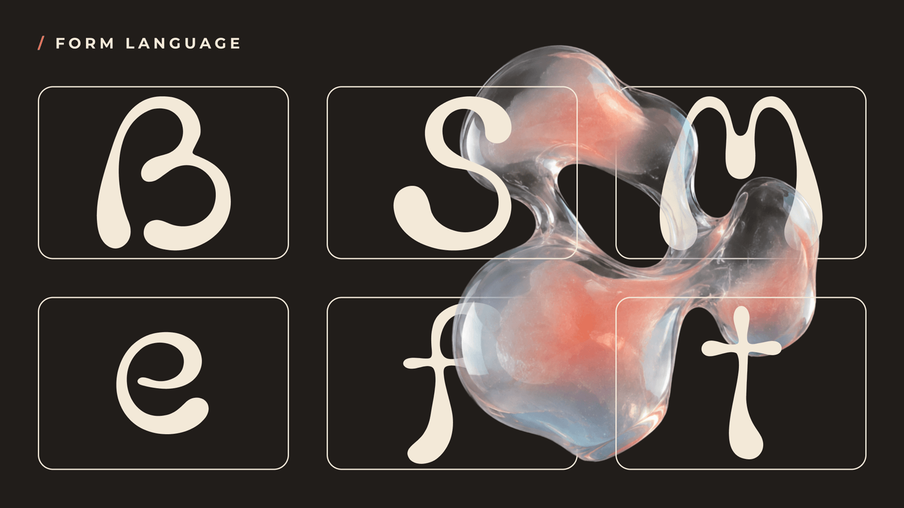
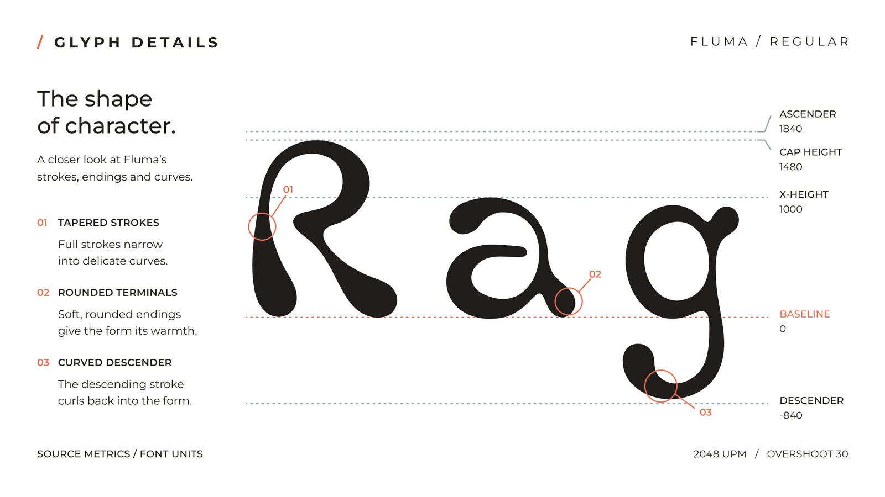
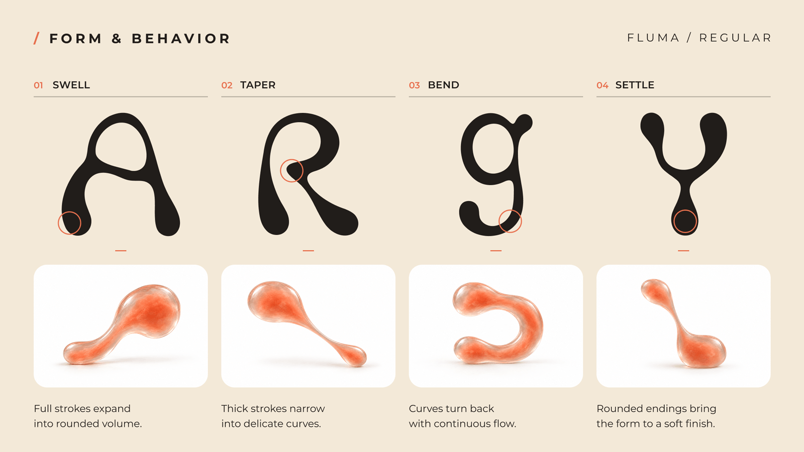
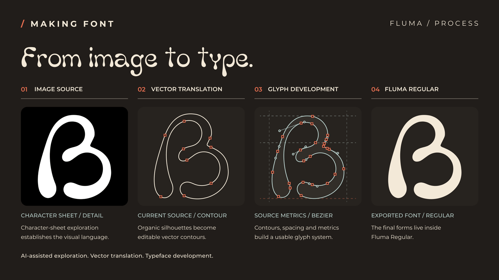
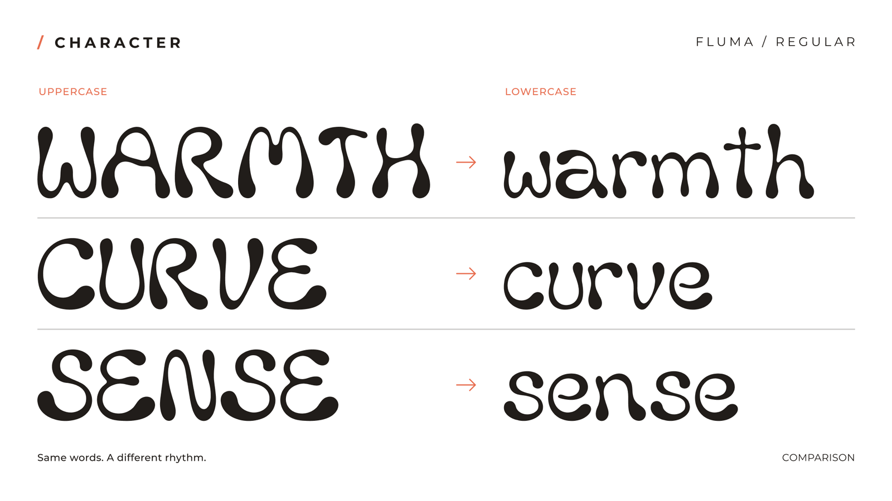
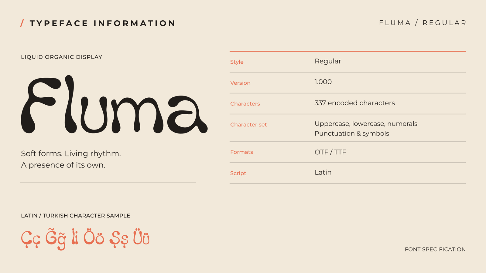

# FLUMA

FLUMA is a liquid organic display typeface with soft, tapering forms. It is intended for headlines, branding, and other display settings. The font covers GF Latin Core, including Turkish (Ç ç Ğ ğ İ ı Ö ö Ş ş Ü ü).


## Try and download

- [Explore Fluma and try the typeface](https://baturaykocatepe.github.io/Fluma-Font/)
- [Download the complete FLUMA pack](https://github.com/baturaykocatepe/Fluma-Font/releases/latest/download/Fluma-Font.zip) (TTF, OTF, WOFF, WOFF2, all 22 specimens, and separate font/image licenses)

The font is open source under the SIL Open Font License 1.1. The specimen images have a [separate CC BY-SA 4.0 license](documentation/image-license.txt). The Google Fonts [submission](https://github.com/google/fonts/issues/11060) is under review; this independent release is available now. The release pack is made with `python3 tools/package_release.py /path/to/Fluma-Font.zip`.

## Design

Fluma explores how flow and organic growth can shape a display alphabet. Its letters swell, taper, and settle, with rounded volumes meeting finer connections. At large sizes, these contrasts give short words a warm, expressive rhythm.







## About

Fluma is designed by Baturay Kocatepe. All 22 current specimen pages appear in sequence in the [specimen gallery](documentation/SPECIMENS.md) and the [article](documentation/article/ARTICLE.en_us.html). The images have a [separate license](documentation/image-license.txt).

Baturay Kocatepe directed the typeface and states that he is its sole copyright holder. The project history records use of GPT Image for an early character sheet, Illustrator Image Trace for vectorization, and Adobe Firefly for some later character references; the resulting shapes were developed in Glyphr Studio. Claude Code assisted with construction of some Turkish and missing Latin characters in the GS2 source. Codex assisted with source corrections, the UFO conversion, OpenType feature generation, and technical QA. This AI-assisted production history is disclosed for review; the editable source and build tools are included.



## Letterforms and character coverage

The following sheets compare uppercase and lowercase forms and summarize the Regular style's Latin character coverage, including Turkish.





## Building

The editable design source is the [Glyphr Studio](https://www.glyphrstudio.com) project `sources/Fluma.gs2`. The build converts it to `sources/Fluma.ufo`, adds OpenType mark positioning and source metadata, compiles TTF and OTF binaries with fontmake, and adds static STAT and Latin script `meta` tables. WOFF and WOFF2 are generated from the resulting TTF.

Exporting directly from Glyphr Studio bypasses the OpenType features in this build. For releases, use the command below after editing the GS2 source.

```sh
python3 -m venv .venv
. .venv/bin/activate
python3 -m pip install -r requirements.txt
bash sources/build.sh
```

- **Primary source:** `sources/Fluma.gs2`. Commit this file when the outlines change.
- **Conversion:** `tools/gs2_to_ufo.py` generates `sources/Fluma.ufo`. The UFO is also kept as a standard editable source for Google Fonts review.
- **Outputs:** `fonts/ttf/Fluma-Regular.ttf`, `fonts/otf/Fluma-Regular.otf`, `fonts/woff/Fluma-Regular.woff`, and `fonts/woff2/Fluma-Regular.woff2`. Google Fonts uses the TTF.
- **Composite helper:** `sources/build_composites.py` is a separate source editing tool for deriving accented letters from base forms. It edits the GS2 file in place and is not part of the normal build. If intentionally regenerating composites, back up and review the source change first:
  ```
  python3 sources/build_composites.py sources/Fluma.gs2 sources/GF_Latin_Core.nam
  ```
- **Quality assurance:** run [Fontspector](https://fonttools.github.io/fontspector/) on the TTF from a directory named `fluma` so its family directory check uses the expected name:
  ```
  mkdir -p /tmp/fluma
  cp fonts/ttf/Fluma-Regular.ttf /tmp/fluma/
  fontspector -p googlefonts /tmp/fluma/Fluma-Regular.ttf
  ```
  See the [current technical readiness report](documentation/TECHNICAL_READINESS-2026-09-30.md), [Fontspector output](documentation/qa/fontspector-2026-09-30-current.md), and [warning review](documentation/qa/WARN_REVIEW-2026-09-30.md). The [initial audit](documentation/TECHNICAL_AUDIT-2026-09-30.md) is retained for comparison.
- **Local inventory:** `python3 tools/audit_font.py` compares source, local Latin Core list, and TTF/OTF metadata and outlines. Visual proofing is still needed for aesthetic decisions.

## Changelog

When you update your font (new version or new release), please report all notable changes here, with a date.
[Font Versioning](https://github.com/googlefonts/gf-docs/tree/main/Spec#font-versioning) is based on semver.

**24 October 2026. FLUMA website and complete download pack (font remains Version 1.000)**

- Refined the website with the supplied FLUMA logo and favicon, a responsive visual story, an interactive type tester, a selected applications carousel, and all 22 specimens in the page gallery.
- Replaced the release ZIP with `Fluma-Font.zip`, containing four font formats, all 22 original specimen images, and separate font/image licenses. The font sources, binaries, and specimen PNGs were not changed.

**24 October 2026. Public download and typeface website (font remains Version 1.000)**

- Published a GitHub Release containing the existing canonical TTF, OTF, WOFF, and WOFF2 binaries with the OFL license.
- Added a simple GitHub Pages site with a live Fluma type tester, selected specimens, and a direct download link. Font sources and binaries were not changed.

**24 October 2026. Specimen and documentation updates (font remains Version 1.000)**

- Replaced page 20 with the designer's corrected image. Its lower-right caption now reads “COMPARISON”. Font sources and binaries were not changed.
- Replaced pages 07 and 19 with the designer's revised images. Page 07 now shows the source ascender and descender values (1840 and -840), and page 19's lower-right caption reads “TITLE EXPLORATION”.
- Zero-padded image filenames for pages 01-09 so file listings sort in specimen order, and updated the article, gallery, and README references. Added selected pages 06, 07, 08, 12, and 21 to the README alongside pages 01 and 20. All 22 pages remain in the article and gallery.

**23 October 2026. Specimen update (font remains Version 1.000)**

- Replaced all 22 specimen PNGs with the designer's revised exports. Font sources and binaries were not changed.
- Replaced pages 19, 20, and 21 again with later designer revisions. The remaining page 20 caption error was corrected on 24 October.

**30 September 2026. Version 1.000 build update**

- Added Ĕ and corrected the previously empty ĕ; restored font license and name metadata.
- Added source-driven UFO/TTF/OTF build, mark attachment, dotless i/j handling, and separator glyphs.
- Removed sub-unit line fragments at UFO conversion when they would become zero-length in TTF outlines; the Google Fonts Fontspector profile now reports 0 FAIL and 12 WARN.
- Added all 22 original specimen images, a browsable gallery, and their separate image license.

**15 September 2026. Version 1.000 source milestone**

- Initial character set complete: GF Latin Core (319 characters), including full Turkish support.

## License

This Font Software is licensed under the SIL Open Font License, Version 1.1.
This license is available with a FAQ at https://openfontlicense.org

Specimen images in `documentation/article/` are licensed separately under CC BY-SA 4.0; see `documentation/image-license.txt`.

## Repository Layout

This font repository structure is inspired by [Unified Font Repository v0.3](https://github.com/unified-font-repository/Unified-Font-Repository), modified for the Google Fonts workflow.
